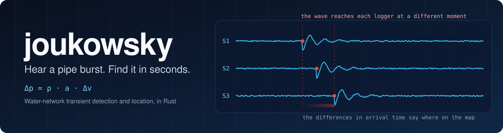
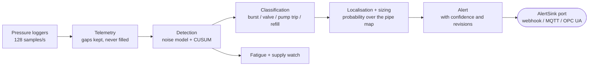
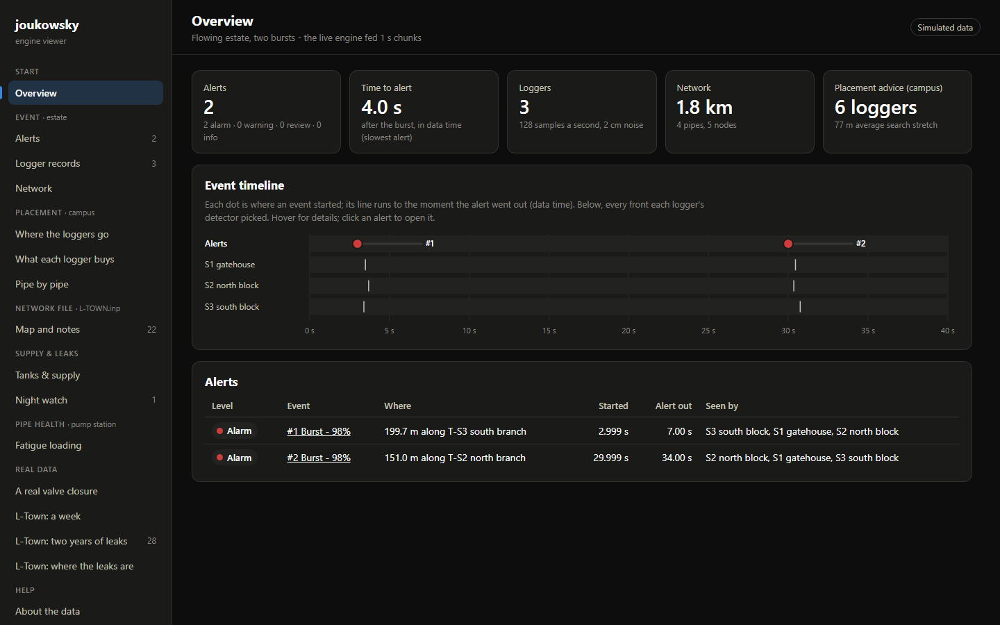
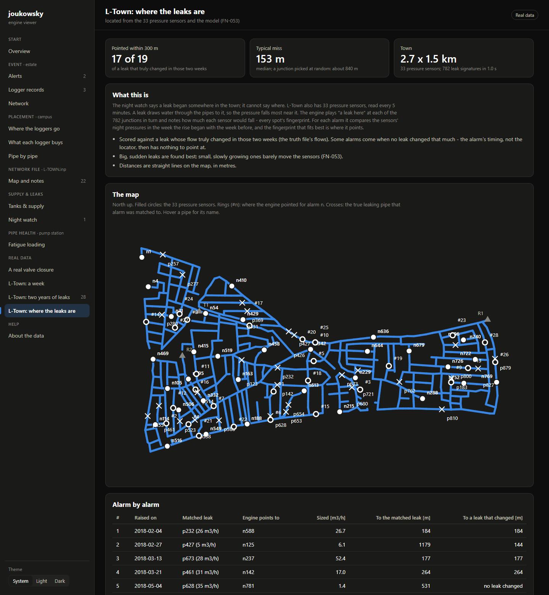

<p align="center">
  
</p>

<p align="center">
  
  
  
  
  
</p>

<p align="center">
  <a href="#why-this-exists">Why</a> &middot;
  <a href="#how-it-works">How it works</a> &middot;
  <a href="#what-it-does">What it does</a> &middot;
  <a href="#see-it">See it</a> &middot;
  <a href="#results">Results</a> &middot;
  <a href="#honest-limits">Limits</a> &middot;
  <a href="#run-it">Run it</a> &middot;
  <a href="#under-the-hood">Under the hood</a>
</p>

---

**joukowsky** is an engine that watches high-rate pressure data from a water network and, within seconds of a burst, says **what happened, where it is on the pipe map, how big it is, and how sure it is.** It takes a site's pipe network and its pressure loggers (128 samples per second) and works out the event from the physics of the pressure wave that every burst sends through the water.

<table align="center">
  <tr>
    <td align="center"><b>~50 000</b><br>lines of Rust</td>
    <td align="center"><b>0</b><br>external crates</td>
    <td align="center"><b>372</b><br>tests, all passing</td>
    <td align="center"><b>30+</b><br>numbered validation cases</td>
    <td align="center"><b>54</b><br>logged findings</td>
  </tr>
</table>

## Why this exists

- South Africa loses about **47%** of its treated water before it is billed (national No Drop reports), much of it through leaks and bursts.
- A burst is usually found **hours or days later**, often only when someone reports it. By then the water is gone and the damage is done.
- A burst announces itself in the first second: a pressure wave runs through the pipes at roughly 1 km/s. If loggers are listening fast enough, the wave can be read.
- Most sites are fed by an unstable municipal supply (load-shedding, pump trips, refills), so the engine has to tell a burst from the many harmless shocks that look like one.

## How it works

**The physics in 30 seconds**

1. A burst drops the pressure and sends a wave along the water. Joukowsky's relation gives the size of the jump: `Δp = ρ · a · Δv`.
2. Each logger hears the wave at a **slightly different moment**.
3. The engine walks those arrival-time differences back along the pipe graph and scores **every pipe**. The answer is a probability region, never a single guess.
4. The size of the drop gives the size of the burst. A transient simulation checks any action the engine would recommend.



## What it does

<table>
  <tr>
    <td width="25%"><b>⚡ Detect</b><br>Robust noise model, CUSUM change detection and step-area onset find the moment something happened.</td>
    <td width="25%"><b>🧩 Classify</b><br>A burst, a valve closing, a pump trip, or a pipe refilling after a supply cut? Rules over physical features.</td>
    <td width="25%"><b>📍 Locate</b><br>Where on the pipe map, as a probability distribution with a credible region. Branch-and-bound keeps it fast.</td>
    <td width="25%"><b>📏 Size</b><br>How large is the burst, worked out from the measured pressure drops.</td>
  </tr>
  <tr>
    <td><b>💧 Slow leaks</b><br>No wave at all: a night-flow balance with a CUSUM alarm, then a fit to the pressure sensors to say where.</td>
    <td><b>🔧 Wear</b><br>Rainflow counting and Miner damage show which pipes are being fatigued by pressure shocks.</td>
    <td><b>🗺️ Plan</b><br>Where to put loggers before buying them, which spots stay blind, and the smallest burst each pipe can show.</td>
    <td><b>⏪ Replay</b><br>Feed a site's recorded files through the live engine, in time order, and get the alerts it would have raised.</td>
  </tr>
</table>

Every answer carries a confidence, and the engine is allowed to say *"I do not know"* instead of guessing.

## See it

`jk view` writes one self-contained web page that shows the engine's work next to the truth.

**A simulated estate, two bursts.** Each red dot is where a burst started; its line runs to the moment the alert went out. Both were called bursts at 98% confidence within 4 seconds, and placed 199.7 m and 151.0 m along their branches, as seen by all three loggers.

<p align="center"></p>

**L-Town, the public benchmark: where the leaks are.** The engine has only the 33 pressure sensors (filled circles) and the pipe model. For each alarm it plays "a leak here" at all 782 junctions, compares each fingerprint with what the sensors saw, and points (rings). The crosses are the true leaks from the competition's answer file. The table under the map lists every alarm, including the ones that missed.

<p align="center"></p>

## Results

| What was checked | Result | Where |
|---|---|---|
| **Physics against exact answers** (wave periods, Joukowsky jumps, friction, plastic walls, pumps, valves, tanks, canals, refilling, vapour and gas cavities) | Most to better than **1 part in a million** | `V-A1 .. V-A19` |
| **The wave solver against an independent method** (transfer matrices) | Within **0.15%** on a branched network | `V-X1` |
| **Simulated estate, bursts of 3-12 mm** | Detected **100%**, called bursts **95-100%**, located within **0.1-0.4 m** (wave speed known) or **5-7 m** (3% speed error), sized within **1-7%**, **no false alerts** in 9 logger-hours of quiet | `V-S` cases |
| **L-Town, slow leaks from 33 pressure sensors** | Within 300 m of a changed leak in **17 of 19 alarms**; median miss **153 m** in a 2.7 km town (a random junction: ~840 m) | `FN-053` |
| **Scale** | Steady-state solver: **1 000 km in 0.3 s** | `jk scale` |
| **Data that breaks** | Gaps, late uploads, bad clocks, drifting clocks and load-shedding power cuts are handled explicitly and tested | `tests/pipeline` |

The first files made by other people (EPANET examples and L-Town) exposed bugs that simulations made in this project never showed. Each is written up and fixed in [`FN-045` to `FN-054`](docs/10_findings/findings_log.txt), together with the negative results, such as growing leaks, where the signal and not the timing is the problem.

## Honest limits

> [!WARNING]
> Most of the evidence above is from simulations (made by this project, and by the competition organisers for L-Town), cross-checked by an independent method, **but not yet by laboratory measurements or a live network.**

- The false-alert rate on a real network is unknown. Real noise is not Gaussian, and real pressure moves for many reasons.
- Real wave speeds must be measured. With 5% doubt, the 90% regions are tens of metres long on long mains.
- Pump starts and valve openings are not classified yet (a valve opening looks like a burst).
- Location on a large municipal network is untested.

Each limit is written down, with the test that would close it, in [`docs/12_the_engine/06_honest_limits.txt`](docs/12_the_engine/06_honest_limits.txt) and [`docs/10_findings/known_gaps.txt`](docs/10_findings/known_gaps.txt).

## Run it

You need Rust 1.98.1 (pinned in `rust-toolchain.toml`). There are no other dependencies and no internet is needed.

```bash
cargo test --workspace                    # all tests; real-data tests skip when the data is absent
cargo run -p jk-cli -- rpv                # a reservoir-pipe-valve water hammer demo
cargo run --release -p jk-cli -- view     # writes jk-view.html (open it in a browser)
cargo run --release -p jk-cli -- scale --km 10 --advise
```

On Windows, `.\tests\run-tests.ps1 -Suite quick` runs the test programs one by one and keeps a readable log. The tests print what they measured next to what the physics predicts, so the logs read like a lesson.

The public datasets (EPANET examples, L-Town, a Texas A&M testbed) are **not included**, because of their licences and size. How they are fetched, fingerprinted and kept apart is in [`data/README.md`](data/README.md). The `view --real` pages need them.

## Under the hood

| Principle | What it means in the code |
|---|---|
| **Physics first** | Every model has a physical meaning. A result that breaks conservation of mass or momentum is a bug. |
| **Built from scratch** | **Zero external crates** (see `Cargo.lock`). The solvers, dense and sparse Cholesky, random numbers, complex numbers, signal processing and statistics are all written in the project. |
| **Uncertainty is an output** | Every detection has a confidence, every location is a distribution, and the engine may abstain. |
| **Clean architecture** | Pure domain crates (no I/O, no clocks) behind ports and adapters. Files come in through adapters; alerts leave through a port. |
| **Expect broken data** | Gaps are kept explicit and never silently filled. Every approximation a reader makes is reported as a note. |
| **Every claim has a test** | Validation ladder: analytical, invariants, simulation, cross-code, public datasets. Each function names the document it implements. |

**The solvers:** method of characteristics for the wave (single pipes and whole networks, with vapour and gas cavities, viscoelastic walls, pumps, valves, check valves, tanks and leaks), an independent transfer-matrix model as a cross-check, a steady-state network solver, and a 1-D Saint-Venant solver for canals and rivers.

<details>
<summary><b>Repository map</b></summary>

```
crates/kernel/                 typed SI units, random numbers, linear algebra, clocks
crates/domain/hydraulics/      Joukowsky relations, MOC solvers, network + steady-state solvers
crates/domain/telemetry/       logger chunks into continuous stretches with explicit gaps
crates/domain/detection/       noise model, baseline, CUSUM, onset, live detector stream
crates/domain/classification/  rules over physical features
crates/domain/localisation/    travel times, posterior over the network, sizing, placement
crates/domain/balance/         night flows and slow-leak watch
crates/domain/channels/        canals and rivers (Saint-Venant)
crates/domain/health/          rainflow counting, fatigue damage
crates/application/            the live monitor, alerts, replay of recorded site files
crates/adapters/files/         EPANET networks, logger CSVs, SCADA tables, site files
crates/sim/                    synthetic towns for testing
crates/interfaces/cli/         the jk command and the viewer
tests/                         validation tests, by context and rung
docs/                          physics, design, validation strategy, findings, a guide to what was built
```

</details>

<details>
<summary><b>Where to start reading</b></summary>

| If you want... | Read |
|---|---|
| The idea in plain words | [`docs/12_the_engine/01_the_engine_in_plain_words.txt`](docs/12_the_engine/01_the_engine_in_plain_words.txt) |
| One burst followed from logger to alert | [`docs/12_the_engine/02_how_an_alert_is_made.txt`](docs/12_the_engine/02_how_an_alert_is_made.txt) |
| The physics | [`docs/02_physics_of_transients`](docs/02_physics_of_transients) |
| How each claim is proven | [`docs/07_validation`](docs/07_validation) |
| What building and testing taught | [`docs/10_findings/findings_log.txt`](docs/10_findings/findings_log.txt) |
| Why the project has this name | [`docs/00_why_joukowsky/the_name.txt`](docs/00_why_joukowsky/the_name.txt) |

</details>

## Why "Joukowsky"

Nikolai Zhukovsky (Joukowsky in French) is remembered for aerodynamics, but in 1897-98 he also solved water hammer. After unexplained pipe failures in Moscow, he ran full-scale experiments on the mains of the whole city and derived the relation between a change in flow speed and the pressure jump it causes. That relation is the starting point of this engine.

## Licence

[PolyForm Noncommercial 1.0.0](LICENSE). You are welcome to read, run, study and modify the code for any non-commercial purpose (learning, research, evaluation, personal projects). Commercial use needs written permission. The public datasets named in data/manifest.csv keep their own licences (EPANET examples: MIT; L-Town and the Texas A&M testbed: CC BY 4.0).
